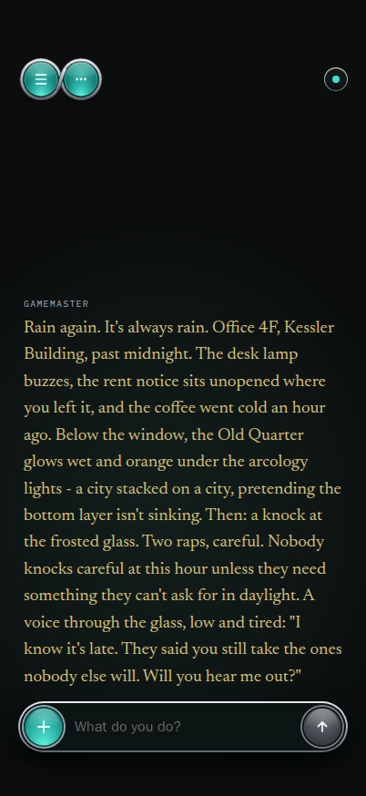

# Coherence

A text role-playing game where a language model plays the game master. You bring your own API key.

## What it is

Coherence is a text adventure in which a language model narrates the world and answers your moves.
You pick a provider (Anthropic, OpenAI, Google Gemini or xAI) and use your own API key; every move sent to the model is billed to your account.
The game runs as two containers: an engine written in Python with FastAPI, and a web client written in React that a small Node server serves.
The engine keeps no game state. Your game lives in your browser, and you can save it to a file and load it back.
The repository ships one sample world, `neon_rain`, and a sample save in `examples/demo-save.json`.

## Why it is interesting

- Some moves stop for a decision before they count: a dice roll, a craft roll, a change to the world's rules, or a wholesale reframe of the world.
- Long-term memory runs locally. Turn text is embedded with a small model that is baked into the engine image, and recalled from the save itself. No embedding service is called.
- Your keys are handled with care. In self-host mode they sit in an encrypted file, and in hosted mode they are held only in browser memory (see `simple-creds-storage` below).
- In hosted mode both containers run on a read-only filesystem with a RAM-only /tmp, as `docker-compose.hosted.yml` sets them. The engine checks its own filesystem and refuses to start otherwise; `scripts/check_hosted.sh` checks both containers. Logs carry no key, no player text and no game state. An automated check verifies this.
- Hosted mode allows one message per 15 seconds for each session and each IP address. Other game requests (undo, starting a game without a model call, and checking or loading a save) are limited to 12 per minute for each session and each IP address.

## Screenshot



## Architecture

```
  browser                      web (Node)                  engine (FastAPI)
  +--------------------+       +-----------------+         +-------------------------+
  | game UI            |  /api | static files    |  /api   | game rules and gates    |
  | save in browser    |------>| proxy to engine |-------->| memory (local embeds)   |
  | or in a save file  |       +-----------------+         | provider adapters       |
  +--------------------+                                   +-----------+-------------+
                                                                       |
                         self-host: encrypted key file (volume)        | your key
                         hosted: key from the browser, in RAM only     v
                                                              Anthropic, OpenAI,
                                                              Gemini or xAI
```

## Quickstart

You need Docker with Compose.

<!-- quickstart -->
```sh
cp .env.example .env
docker compose up -d --build
```
<!-- /quickstart -->

Open http://localhost:8080 (the port is `WEB_PORT`; the page is served on the loopback address only).
Open Settings, unlock the key store with a passphrase of your choice (the first unlock creates the store), and add the key for your provider.
Then start a new game.

To run the hosted variant, which keeps keys off disk, add the second compose file:

```sh
docker compose -f docker-compose.yml -f docker-compose.hosted.yml up -d --build
```

The hosted file also defines a Cloudflare Tunnel service in the `wan` profile. It is never started by default and it needs `TUNNEL_TOKEN`; an empty token makes it exit.

## Configuration

Copy `.env.example` to `.env` and change what you need. Nothing in that file is a secret. In hosted mode the engine ignores `.env` and reads `.env.example` as shipped.

| Variable | Default | Meaning |
|---|---|---|
| `COHERENCE_MODE` | `selfhost` | `selfhost` or `hosted`. |
| `WEB_PORT` | `8080` | Host port of the web page, bound to 127.0.0.1. |
| `ENGINE_URL` | `http://engine:8000` | Where the web server finds the engine. |
| `BODY_CAP_BYTES` | `134217728` | Largest request body, in bytes. Larger bodies get a 413. When you run it yourself, the bodies of all requests in progress together also stay within this size; a request that would go over gets a 503 (busy) and can be sent again. |
| `TUNNEL_HOST` | set by `docker-compose.hosted.yml` to `cloudflared` | Host name of the tunnel container. Only a request from that container may name the client, through Cloudflare's `CF-Connecting-IP` header; every other request counts under its own connection address. The tunnel's ingress must target `http://web:8080`. |
| `ANTHROPIC_MODEL_FAST`, `ANTHROPIC_MODEL_STRONG` | see `.env.example` | Model ids for the two tiers on Anthropic. |
| `OPENAI_MODEL_FAST`, `OPENAI_MODEL_STRONG` | see `.env.example` | Model ids for the two tiers on OpenAI. |
| `XAI_MODEL_FAST`, `XAI_MODEL_STRONG` | see `.env.example` | Model ids for the two tiers on xAI. |
| `GEMINI_MODEL_FAST`, `GEMINI_MODEL_STRONG` | see `.env.example` | Model ids for the two tiers on Gemini. |
| `UNDO_CAP` | `25` | How many undo steps a save keeps. |
| `UNLOCK_PER_MINUTE` | `5` | Key-store unlock attempts allowed per minute for each IP address. |
| `VAULT_IDLE_TTL_S` | `1800` | Seconds of inactivity before an unlocked key store locks again. |
| `KEYS_DIR` | `/data/keys` | Where the encrypted key file lives, on a Docker volume. |
| `TRUSTED_PROXY_CIDRS` | the IPv4 private ranges (10/8, 172.16/12, 192.168/16) | Peers whose `X-Forwarded-For` header the engine believes. |
| `TRUSTED_PROXY_HOPS` | `1` | Which entry of `X-Forwarded-For`, counted from the right, is the client. If the header has fewer entries, the peer address is used. The web server discards forwarding headers it receives and always sends the client address, then the address it received the request from; hosted mode uses `2`. |
| `RATE_LIMIT_MAX_KEYS` | `100000` | Most sessions and addresses the limiter remembers. The oldest are dropped first. |
| `MESSAGE_INTERVAL_SECONDS` | hosted 15, self-host 0 | Seconds between two messages for one session and for one IP. 0 turns the limit off. Hosted mode refuses to start below 15. |
| `ESCALATION_HMAC_KEY` | random per start | Signing key for consent tokens. Empty means a new random key at each start. |
| `DEFAULT_PACK_ID` | `neon_rain` | The world pack a new game uses. |
| `MAX_CONCURRENT_REQUESTS` | `4` | Most game requests the engine runs at once. Further requests get a 503 at once, without waiting. |
| `VAULT_MAX_SESSIONS` | `64` | Most unlocked key-store sessions held at once. The least recently used one is locked first. |

The web client sends a per-page session id with every request, and the message limit counts it together with the IP address.

## Tests

Tests run in containers. The project name `coherence-standalone-test` keeps the cleanup from touching the volumes of your own install.

```sh
docker compose -p coherence-standalone-test --profile test run --rm engine-test
docker compose -p coherence-standalone-test --profile test run --rm engine-test-hosted
docker compose -p coherence-standalone-test --profile test run --rm web-test
docker compose -p coherence-standalone-test --profile test run --rm e2e npx playwright test specs/selfhost.spec.ts specs/screenshot.spec.ts
docker compose -p coherence-standalone-test --profile test down -v
```

`scripts/test.sh` runs these and the hosted-mode check in order, and also runs the compose, repository and fresh-volume checks; it writes the log to `test-output.log`.
The engine tests use a fake provider that is switched on only by a test variable and is never listed in `.env.example`.

## simple-creds-storage

`simple-creds-storage/` is a small Python package of its own, and the engine's only way to keep keys in self-host mode.

- Cipher and key derivation: AES-256-GCM, with the key derived from your passphrase by PBKDF2-SHA256 at 600,000 iterations.
- File layout: one JSON file holding a format header and the ciphertext; the header is bound to the ciphertext as authenticated data, the file is mode 0600 in a 0700 directory, and each write goes to a temporary file that replaces the old one.
- Vault: an unlocked store is kept in RAM only, per session, and it locks again after the idle time.
- Threat model: it protects keys at rest from someone who copies the volume; it does not protect against an attacker who controls the running engine.

## Status

- Earlier development history is not included; this repository starts at its first commit.
- The wish cache is per save and is not shared across players.
- Quality on providers other than Claude is unproven.
- Browser saves are kept in this browser's IndexedDB storage, encrypted with your save passphrase; if the browser refuses a write, the game offers the save file.
- The content filter checks every save before it is opened or played. A save that holds text the filter blocks, including some saves made before the filter became stricter, cannot be opened; a browser save stays listed and can be saved to a file and removed. A save with more text than a hosted server checks (500,000 characters) cannot be opened there. When you run it yourself there is no text limit; the request size limit (`BODY_CAP_BYTES`, 128 MiB by default) still applies to the whole save. Large saves are heavy in the browser. In automated tests of the self-host build, a save of about 17 MiB with 5,000 story entries crashed the page when the browser and the test runner together had 2 GiB of memory, and used up to about 3.5 GiB when they had 4 GiB. The number of entries matters as well as the size: a save of about 0.5 MiB with 5,000 entries used about 2.9 GiB and did not show the story within two minutes of a reload.
- The sample save is a new `neon_rain` game made with the test provider. Its story is the pack's opening scene.

## License

PolyForm Noncommercial License 1.0.0. See `LICENSE`. Third-party material is listed in `THIRD_PARTY_NOTICES.md`.
